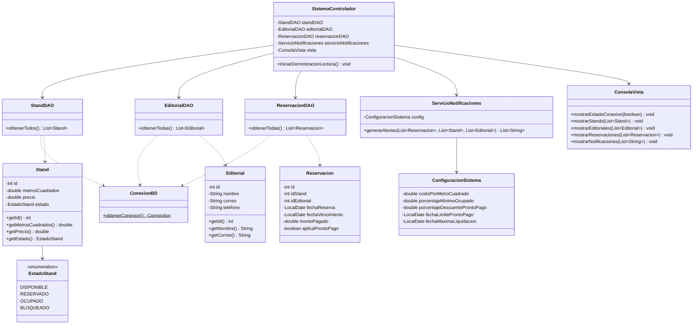
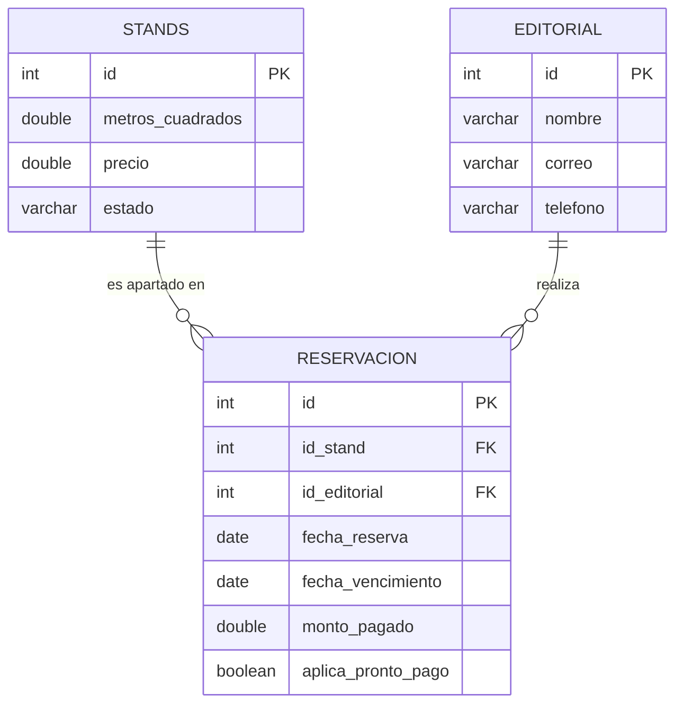

# Sistema Administrativo de Venta de Stands - FILEY (PD2 + PD4)

## 1. Descripción General y Requisitos
Sistema administrativo en línea de comandos para gestionar los espacios (stands) de la Feria Internacional de la Lectura Yucatán (FILEY), sus reservaciones por parte de editoriales y el envío de notificaciones automáticas de vencimiento.

### Estados de un Stand
* **DISPONIBLE:** El espacio está libre para ser apartado o adquirido.
* **RESERVADO:** Apartado por una editorial ("pago después") con una fecha límite de vigencia.
* **OCUPADO:** La editorial ha cubierto el porcentaje mínimo requerido del costo total del stand.
* **BLOQUEADO:** Reservación interna especial realizada por el administrador previo al despliegue del sistema (negociación previa). Puede liberarse a disponible o transferirse a reservado.

---

## 2. Casos de Uso e Historias de Usuario (Base PD2)

### Casos de Uso
1. **CU-01 Consultar Catálogo de Stands:** El sistema permite visualizar todos los stands con su identificador, área en $m^2$, costo calculado y estado actual (`DISPONIBLE`, `RESERVADO`, `OCUPADO`, `BLOQUEADO`).
2. **CU-02 Gestionar Reservaciones y Pagos:** El sistema registra el vínculo entre una Editorial y un Stand, controlando la vigencia del apartado, el descuento por pronto pago y el porcentaje cubierto.
3. **CU-03 Emitir Notificaciones de Vencimiento:** El sistema evalúa las fechas configuradas y notifica a las editoriales cuando su reserva está por vencer, cuando el beneficio de pronto pago está próximo a expirar o cuando la fecha máxima para cubrir el porcentaje de ocupación está cerca.

### Historias de Usuario
* **HU-01 (Administrador):** *Como* administrador de la FILEY, *quiero* visualizar el listado completo de stands, editoriales y reservaciones almacenados en la base de datos *para* conocer la ocupación actual de la feria.
* **HU-02 (Administrador):** *Como* administrador del sistema, *quiero* bloquear stands específicos antes del despliegue general *para* asegurar espacios en negociación interna y transferirlos posteriormente a la editorial correspondiente.
* **HU-03 (Editorial):** *Como* representante de una editorial, *quiero* recibir notificaciones oportunas sobre el vencimiento de mi reserva y las fechas límite de pronto pago *para* liquidar mi stand a tiempo sin perder mi descuento ni mi espacio.

---

## 3. Arquitectura MVC + Capa de Base de Datos (JDBC)
El proyecto está estructurado aplicando separación de responsabilidades:
* **Modelo (`mx.uady.filey.modelo`):** Clases que representan las entidades del dominio (`Stand`, `Editorial`, `Reservacion`, `EstadoStand`).
* **Acceso a Datos / DAO (`mx.uady.filey.dao` y `config`):** `ConexionBD` administra la conexión mediante **JDBC** a la base de datos en memoria **H2**, mientras que `StandDAO`, `EditorialDAO` y `ReservacionDAO` ejecutan las consultas `SELECT` de lectura.
* **Servicio / Lógica de Negocio (`mx.uady.filey.servicio`):** `ServicioNotificaciones` procesa las reglas de negocio y plazos definidos en `ConfiguracionSistema`.
* **Vista (`mx.uady.filey.vista`):** `ConsolaVista` formatea e imprime en consola las tablas leídas y las alertas.
* **Controlador (`mx.uady.filey.controlador`):** `SistemaControlador` comunica los DAOs y servicios con la Vista, siendo invocado desde `Main.main()`.

---

## 4. Diagrama de Clases (UML)

---

## 5. Diagrama Entidad-Relación (Stands, Editorial y Reservación)

---

## 6. Video Explicativo
* **Enlace al video (Máximo 5 min):** [AQUÍ PEGA EL LINK DE TU VIDEO DE DRIVE / YOUTUBE / SHAREPOINT]