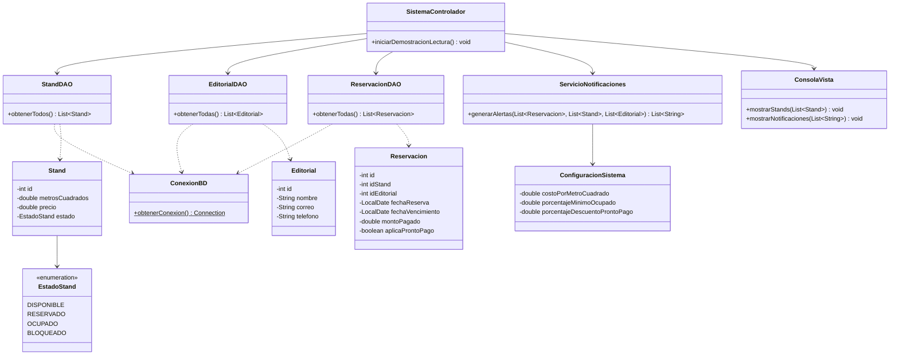
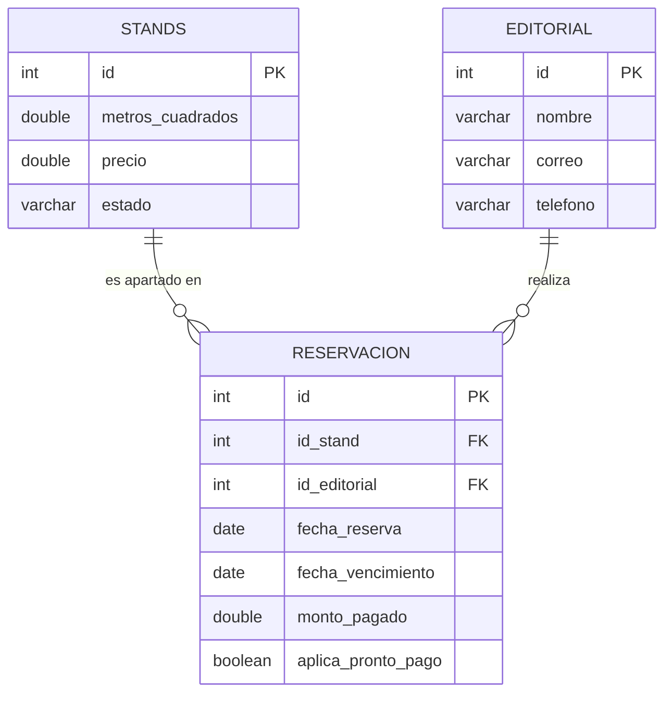

# Arquitectura y Diseño del Sistema

## 1. Patrón MVC + Capa de Base de Datos (JDBC)
El proyecto está estructurado aplicando separación de responsabilidades:
* **Modelo (`modelo`):** Clases que representan las entidades del dominio (`Stand`, `Editorial`, `Reservacion`, `EstadoStand`).
* **Acceso a Datos / DAO (`dao` y `config`):** `ConexionBD` administra la conexión mediante **JDBC** a la base de datos en memoria **H2**, mientras que los DAOs ejecutan las consultas `SELECT` de lectura.
* **Servicio (`servicio`):** `ServicioNotificaciones` procesa las reglas de negocio y plazos definidos.
* **Vista (`vista`):** `ConsolaVista` formatea e imprime en consola las tablas leídas y las alertas.
* **Controlador (`controlador`):** `SistemaControlador` comunica los DAOs y servicios con la Vista.

---

## 2. Diagrama de Clases (UML)

---

## 3. Diagrama Entidad-Relación

